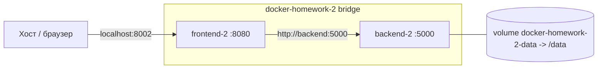
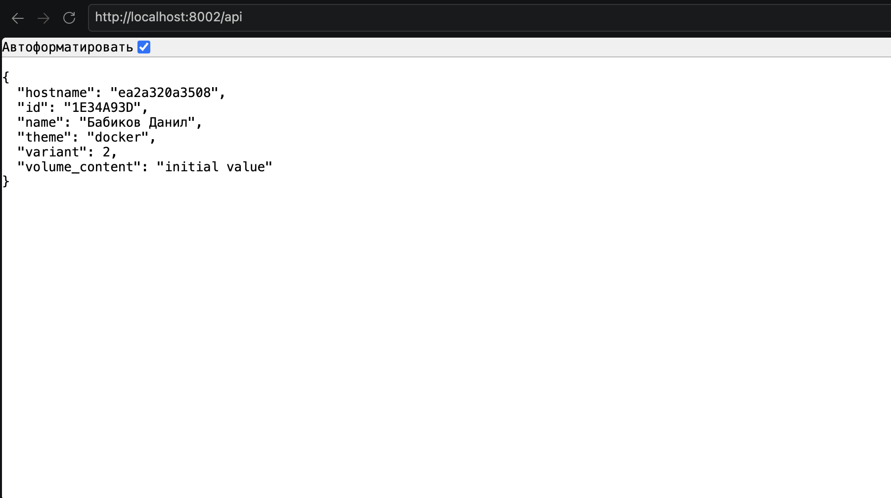

# Отчёт по домашнему заданию «Контейнеризация и Docker»

Вариант: N = 2  
Персональный идентификатор: 1E34A93D  
Проект: docker-homework-2  
Внешний порт: 8002

---

## 1. Схема стенда

```
host:8002 ──► frontend-2 (172.20.0.3:8080)
                  │
                  │  http://backend:5000 (DNS-имя в сети)
                  ▼
             backend-2 (172.20.0.2:5000) ── /data ◄── volume docker-homework-2-data
```

Оба контейнера находятся в пользовательской bridge-сети `docker-homework-2` (172.20.0.0/16). На хост публикуется только порт frontend (8002 → 8080). Backend портов на хост не публикует.

Mermaid-диаграмма:



---

## 2. Результаты проверок

### 2.1. Главная страница и /api

```
$ curl -i http://localhost:8002/
HTTP/1.1 200 OK
Content-Type: text/html; charset=utf-8
<h1>Фронтэнд Вариант 2</h1><p><a href='/api'>/api</a></p>

$ curl -s http://localhost:8002/api | python3 -m json.tool
{
    "hostname": "0cd6f4ef6edb",
    "id": "1E34A93D",
    "name": "Бабиков Данил",
    "theme": "docker",
    "variant": 2,
    "volume_content": "changed-in-volume"
}
```

### 2.2. Контейнеры и сеть

```
$ docker ps
CONTAINER ID   IMAGE        STATUS                    PORTS
...            frontend:2   Up (healthy)              0.0.0.0:8002->8080/tcp
...            backend:2    Up (healthy)

$ docker port backend-2
(пусто)

$ docker network inspect docker-homework-2
Driver: bridge
Subnet: 172.20.0.0/16
Containers:
    backend-2  172.20.0.2
    frontend-2 172.20.0.3
```

### 2.3. Лимиты ресурсов

```
$ docker inspect backend-2 frontend-2 \
    --format '{{.Name}} cpus={{.HostConfig.NanoCpus}} mem={{.HostConfig.Memory}}'
/backend-2  cpus=500000000  mem=268435456
/frontend-2 cpus=500000000  mem=268435456
```

`500000000` = 0.5 CPU, `268435456` = 256 MiB — лимиты применены к обоим контейнерам.

### 2.4. Healthcheck

Оба контейнера в `docker ps` показывают `Up (healthy)` через ~10–15 секунд после старта. Healthcheck задан в каждом Dockerfile:

```dockerfile
HEALTHCHECK --interval=10s --timeout=3s --retries=3 \
  CMD python -c "import urllib.request; urllib.request.urlopen('http://localhost:5000/').read()" || exit 1
```

В логах backend видны соответствующие `GET /` каждые 10 секунд с `127.0.0.1`.

### 2.5. Volume переживает пересоздание backend

```
Шаг 1. Исходный backend-2 (hostname ea2a320a3508):
    docker exec backend-2 sh -c 'echo changed-in-volume > /data/backend_data.txt'
    -> volume_content = "changed-in-volume"

Шаг 2. docker rm -f backend-2 + docker run с тем же volume:
    -> hostname = df4e2816ef1e (новый контейнер)
    -> volume_content = "changed-in-volume"   (данные сохранились)

Шаг 3. Перезапуск через ./scripts/start.sh:
    -> hostname = 0cd6f4ef6edb (снова новый контейнер)
    -> volume_content = "changed-in-volume"   (данные снова сохранились)
```

Смена hostname при неизменном `volume_content` — прямое доказательство, что данные лежат в volume, а не в слое контейнера.

---

## 3. Расследование неисправности (N % 4 = 2)

По заданию: указать во frontend неправильное имя backend.

### 3.1. Симптом

```
$ curl -i http://localhost:8002/
HTTP/1.1 200 OK
(страница frontend отдаётся)

$ curl -i http://localhost:8002/api
HTTP/1.1 502 BAD GATEWAY
{"backend_host":"wrong-backend",
 "error":"HTTPConnectionPool(host='wrong-backend', port=5000): Max retries exceeded
          ... Failed to resolve 'wrong-backend' ([Errno -2] Name or service not known)"}
```

Frontend работает, а обращения к backend — нет.

### 3.2. Гипотезы

1. Backend-контейнер остановлен или упал.
2. Во frontend указано неверное имя backend.
3. Backend отключён от пользовательской сети.

### 3.3. Проверки и результаты

Проверка гипотезы 1:

```
$ docker ps -a
frontend-2  Up 26 seconds (healthy)
backend-2   Up About a minute (healthy)
```

Оба живы — гипотеза 1 отпадает.

Проверка гипотезы 3:

```
$ docker network inspect docker-homework-2
Containers:
    backend-2  172.20.0.2
    frontend-2 172.20.0.3
```

Оба контейнера в сети, IP выданы — гипотеза 3 отпадает.

Проверка гипотезы 2:

```
$ docker exec frontend-2 env | grep BACKEND
BACKEND_HOST=wrong-backend
BACKEND_PORT=5000
```

Прямая улика: имя backend задано неверно.

```
$ docker exec frontend-2 getent hosts backend
172.20.0.2      backend
```

Правильное имя резолвится в адрес backend — DNS для backend работает.

```
$ docker exec frontend-2 getent hosts wrong-backend
(пусто)
```

DNS-имени `wrong-backend` в сети нет.

```
$ docker logs backend-2
... GET / от 172.20.0.3 ...   (только до момента внесения неисправности)
далее только GET / от 127.0.0.1 (healthcheck)
```

После замены frontend запросов от него в backend не приходило — трафик не доходил.

```
$ docker logs frontend-2
(только startup + GET / от healthcheck)
```

Сам frontend жив, обработчик `/api` падает на этапе резолвинга имени.

```
$ curl -v http://localhost:8002/api
< HTTP/1.1 502 BAD GATEWAY
```

502 от frontend, до backend запрос не доходит.

### 3.4. Подтверждённая причина

Во frontend задана переменная окружения `BACKEND_HOST=wrong-backend`. Такого DNS-имени в сети `docker-homework-2` нет, поэтому `requests.get` внутри обработчика `/api` падает с `NameResolutionError`, и обработчик возвращает 502.

### 3.5. Внесённое исправление

Пересоздание frontend с корректным `BACKEND_HOST=backend`. Выполнено повторным запуском `./scripts/start.sh` — он всегда пересоздаёт контейнеры с правильной конфигурацией.

### 3.6. Повторная проверка

```
$ curl -i http://localhost:8002/api
HTTP/1.1 200 OK
{"hostname":"0cd6f4ef6edb","id":"1E34A93D","name":"Бабиков Данил",
 "theme":"docker","variant":2,"volume_content":"changed-in-volume"}
```

`volume_content` = `"changed-in-volume"` сохранилось с прошлой проверки — дополнительное подтверждение корректной работы volume после инцидента.

---

## 4. Три самостоятельно принятых решения

1. **Сетевой alias `backend` при имени контейнера `backend-2`.**
   В `docker run` backend запускается с `--network-alias backend`, а frontend обращается к `http://backend:5000`. Это отделяет DNS-имя, которое использует frontend, от фактического имени контейнера. При переименовании или пересоздании контейнера конфиг frontend менять не нужно.

2. **Healthcheck через встроенный `urllib`, а не через установку `curl` или `requests` в образ.**
   Оба образа на `python:3.11-slim`; `urllib.request` есть в стандартной библиотеке, поэтому `HEALTHCHECK` не добавляет пакетов в образ и не увеличивает время сборки. `curl` в slim-образе отсутствует, а `requests` уже стоит только во frontend.

3. **Персональный идентификатор зафиксирован прямо в `backend/app.py`, без `.env`.**
   По заданию ID не является секретом, а количество конфигурируемых параметров минимально (`N`, `PERSONAL_ID`, `BACKEND_HOST`). При росте числа параметров или появлении секретов имело бы смысл перейти на `--env-file`.

---

## 5. Один недостаток решения и способ его улучшить

**Недостаток.** `scripts/start.sh` запускает `frontend` сразу после `backend`, не дожидаясь, пока backend станет `healthy`. Если backend стартует дольше обычного, первые запросы к `/api` будут получать 502, хотя стенд в итоге поднимется. Healthcheck-цикл не блокирует `start.sh`.

**Улучшение.** Добавить в `start.sh` ожидание статуса `healthy` перед запуском frontend:

```bash
echo "Ожидание готовности backend..."
for i in {1..30}; do
  status=$(docker inspect --format '{{.State.Health.Status}}' "backend-${N}" 2>/dev/null || echo unknown)
  if [ "$status" = "healthy" ]; then
    echo "backend готов"
    break
  fi
  sleep 1
done
```

Это гарантирует, что frontend появится в сети только когда backend реально отвечает. Дополнительно можно добавить retry/backoff в обработчик `/api` на frontend — это защитит от кратковременных сетевых сбоев уже после старта.

---

## 6. Скриншот

успешный ответ `http://localhost:8002/api` в браузере



---

## 7. Multi-stage build

Multi-stage build не требуется: оба сервиса — интерпретируемый Python (Flask), этапа компиляции нет. В Dockerfile нет шага сборки, который можно было бы вынести в отдельный stage. Каждый образ собирается за один этап из `python:3.11-slim` и копирует только исходники и зависимости.